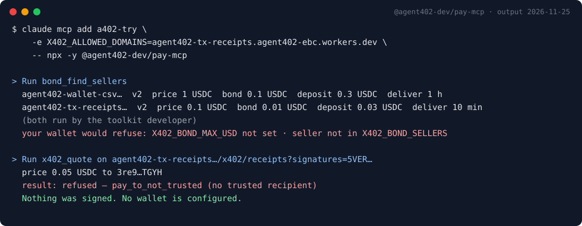

# Agent402 toolkit (Solana)

[](https://github.com/agent402-dev/agent402-toolkit/actions/workflows/ci.yml)

> **A402 (v1) is deprecated.** The token payment option is now **PREQ** (mint `aTbGw3gU5JyJkAdXLj8rYZ3mCXkPbyHjtTAyCX3jQLX`). Official addresses: https://claude.ai/artifact/S6UafAfViJk3DJeMsDMAja

Open-source tools from Agent402 for Solana: factual token checks, and [x402](https://github.com/coinbase/x402) payments in USDC and PREQ (a Token-2022 token).

> Factual information from public on-chain data. Not investment advice.

Not related to `agent402.tools`, `@agents402` or other similarly named sites, accounts or projects, including projects named "a402" on other chains.

**New here?** [Try it in one minute](docs/getting-started.md#try-it-in-one-minute-no-wallet-nothing-paid) with no wallet (live sellers and prices, nothing paid), then [Getting started](docs/getting-started.md): let your AI agent pay for an API, or get paid by AI agents, in a few minutes.




## Packages
| Package | What it is |
|---|---|
| [`@agent402-dev/check-engine`](packages/check-engine) | Reads public on-chain data for a token mint and returns facts with evidence addresses (authorities, Token-2022 extensions, holders, liquidity locks, operator locks, early buys) |
| [`@agent402-dev/check-mcp`](packages/check-mcp) | MCP server for the checks. Free: summary from the hosted API, full report on your machine with your own RPC |
| [`@agent402-dev/pay-server`](packages/pay-server) | Server helpers to accept x402 payments in USDC and, optionally, PREQ through external facilitators (verify → your handler → settle). Optional `/bond` entry for sellers running Agent402 Bond deals (takes a signer, never a key) |
| [`@agent402-dev/pay-mcp`](packages/pay-mcp) | MCP server that lets an AI agent pay x402 APIs and take part in Agent402 Bond deals as a buyer, from your own wallet, on your machine, within limits and allowlists you set (with no configuration, every payment is refused) |
| [`@agent402-dev/bond-seller-mcp`](packages/bond-seller-mcp) | MCP server that lets an AI agent sell jobs backed by Agent402 Bond deals (USDC or PREQ), from your own seller wallet, on your machine: prepare deals, do the work, mark delivery, settle |
| [`@agent402-dev/bond-client`](packages/bond-client) | Instruction builders and the settlement rules (deadlines, possible actions, settlement preview) for the Agent402 Bond program (beta, below), plus a two-agent example |

## Agent402 Bond (Solana program, beta)
A performance bond for one deal: the seller locks a bond, the buyer may lock a deposit, and the outcome follows only the parties' signatures and the Solana clock. Program `9hiCZZ6ddFG9oJBR1Su43Pj4JRFHeHC5cGiCgXtTuAaK` on mainnet, with no upgrade authority. Source, tests and how to check the deployed code: [`programs/`](programs). Terms: [docs/bond/TERMS.md](docs/bond/TERMS.md). Internal review (not an independent audit): [docs/bond/INTERNAL-REVIEW.md](docs/bond/INTERNAL-REVIEW.md).

Two agents running a bonded job over HTTP follow the [Bond Job Protocol](docs/bond/JOB-PROTOCOL.md): sellers use `@agent402-dev/pay-server/bond` (or `@agent402-dev/bond-seller-mcp` when an AI agent does the work), buying agents use `@agent402-dev/pay-mcp`. **Try it with your own AI agent, locally and without real funds:** [`packages/pay-mcp/examples/bond-local`](packages/pay-mcp/examples/bond-local). Sellers are listed in the [seller directory](directory) (`bond_find_sellers`); the developer runs two of them: [wallet activity CSV](docs/services/wallet-csv.md) (1 USDC per job) and transaction receipts (0.1 USDC per job). Code-level example with a seller service, a buyer agent and a local demo: [`packages/bond-client/examples/job`](packages/bond-client/examples/job).

### Agent402 Bond v2 (beta)
Program `Dpvdw53zwFbNhNp4KiTBXS1SNge467M8frtHn2Gr36Ev` on mainnet, with no upgrade authority. Both parties sign each deal, which also records a hash of the job and of the delivered result; payouts go to accounts fixed at opening. Source, tests and how to check the deployed code: [`programs-v2/`](programs-v2). Terms: [docs/bond/TERMS-v2.md](docs/bond/TERMS-v2.md). Job protocol: [docs/bond/JOB-PROTOCOL-v2.md](docs/bond/JOB-PROTOCOL-v2.md). Internal review (not an independent audit): [docs/bond/INTERNAL-REVIEW-v2.md](docs/bond/INTERNAL-REVIEW-v2.md). Buyers use the `bond_v2_*` tools in `@agent402-dev/pay-mcp`; sellers use `@agent402-dev/pay-server/bond-v2` or `@agent402-dev/bond-seller-mcp` with `BOND_SELL_PROTOCOL=2`.

## What this toolkit does not do
- It **does not operate a facilitator.** Payment verification and settlement are done by external x402 facilitators (for example PayAI).
- It **does not hold funds.** Payments go from the buyer's wallet directly to the seller's receiving address. The Bond program's deal vaults are controlled only by the program's rules; no Agent402 key can move them.
- It **does not exchange** currencies. The PREQ rate is used only to compute a PREQ price; there is no PREQ ↔ USDC conversion.
- It **does not accept or send payments on anyone's behalf.** The payment MCP signs with your own wallet on your machine; the server SDK takes only your public receiving address.
- It **does not judge, score or rate tokens** and gives no investment advice.

## Amounts and units
USDC and PREQ both have 6 decimals. In x402 requirements, limits and logs, amounts are in the **smallest unit** unless marked otherwise: 1 USDC = 1,000,000 and **1 PREQ = 1,000,000 smallest units**. Tool outputs add the unit next to each amount (for example `"amountDisplay": "140,000 PREQ"`).

## Development
```bash
npm install
npm test
npm run typecheck
```
Node 20+. Tests run offline (recorded public mainnet data and local fakes).

## License
[Apache License 2.0](LICENSE). See [NOTICE](NOTICE).

---
Factual information from public on-chain data. Not investment advice.
