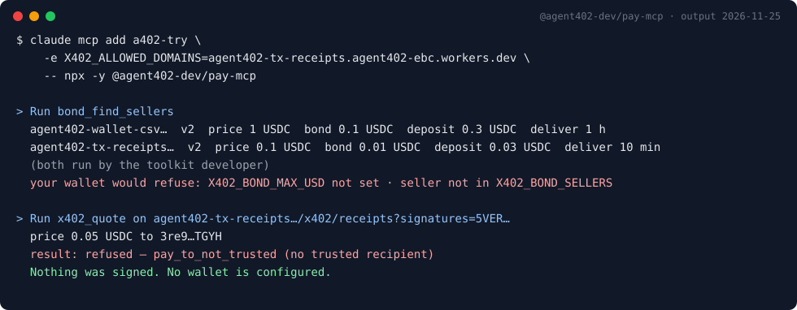

# Getting started

Two paths, each a few minutes. Everything runs on your own machine or your own Cloudflare account, from wallets you create for this. Not investment advice.

- [Try it in one minute (no wallet, nothing paid)](#try-it-in-one-minute-no-wallet-nothing-paid)
- [Buyer: let your AI agent pay for an API](#buyer-let-your-ai-agent-pay-for-an-api) ([How to pay](#how-to-pay-faq))
- [Seller: get paid by AI agents](#seller-get-paid-by-ai-agents)

Try it without real funds first: [`packages/pay-mcp/examples/bond-local`](../packages/pay-mcp/examples/bond-local) runs a seller and your agent against a local mainnet fork.

## Try it in one minute (no wallet, nothing paid)

See live sellers and real prices from your agent before creating any wallet. Without a wallet and without trusted recipients, pay-mcp cannot pay anything.

Claude Code:

```bash
claude mcp add a402-try \
  -e X402_ALLOWED_DOMAINS=agent402-tx-receipts.agent402-ebc.workers.dev \
  -- npx -y @agent402-dev/pay-mcp
```

(Other MCP clients: command `npx`, args `["-y", "@agent402-dev/pay-mcp"]`, the same `env`.)

Or install pay-mcp with its `buy-bonded-job` skill as a Claude Code plugin: `claude plugin marketplace add agent402-dev/agent402-toolkit`, then `claude plugin install agent402-pay@agent402`. In Codex: `codex plugin marketplace add agent402-dev/agent402-toolkit`, then `codex plugin add agent402-pay@agent402` (needs git on PATH). The plugin starts the server with no settings, so every payment is refused.

Then ask your agent:

1. **"Run bond_find_sellers."** It reads the open seller directory and each seller's live terms: price, seller bond, deposit, delivery time, review window, and which of your settings would refuse the deal.
2. **"Run x402_quote on https://agent402-tx-receipts.agent402-ebc.workers.dev/x402/receipts?signatures=5VERv8NMvzbJMEkV8xnrLkEaWRtSz9CosKDYjCJjBRnbJLgp8uirBgmQpjKhoR4tjF3ZpRzrFmBV6UjKdiSZkQUW"** It shows the x402 price (0.05 USDC) and the recipient, and answers `refused` because no recipient is trusted yet: nothing is signed.
3. **"Run wallet_status."** It shows the limits that would apply once you add a wallet.



The two sellers in the directory today are run by the toolkit developer, and are marked so. When you want to pay for real, continue below.

**Skills for agents.** Each MCP server also publishes its workflow as a skill through the MCP [Skills extension](https://modelcontextprotocol.io/extensions/skills/overview), so a host that supports it can load the steps and the rules when needed: `skill://buy-bonded-job/SKILL.md` ([pay-mcp](../packages/pay-mcp/README.md#skill-buy-bonded-job-skills-over-mcp)), `skill://sell-bonded-job/SKILL.md` ([bond-seller-mcp](../packages/bond-seller-mcp/README.md#skill-sell-bonded-job-skills-over-mcp)) and `skill://token-facts/SKILL.md` ([check-mcp](../packages/check-mcp/README.md#skill-token-facts-skills-over-mcp)). Other clients see them as plain resources.

## Buyer: let your AI agent pay for an API

`@agent402-dev/pay-mcp` is an MCP server that pays [x402](https://github.com/coinbase/x402) APIs in USDC on Solana from a wallet on your machine. It refuses every payment until you name the domains and recipients it may pay and set limits.

**1. Create a small wallet just for the agent**

```bash
npx -y @agent402-dev/pay-mcp init
```

It writes `~/.agent402/pay-wallet.json`, prints the address, and shows how to fund it. Send a few USDC and about 0.01 SOL for network fees. Keep only what you are willing to let the agent spend.

**2. Connect it to your agent with your own rules**

Claude Code:

```bash
claude mcp add a402-pay \
  -e X402_KEYPAIR_PATH="$HOME/.agent402/pay-wallet.json" \
  -e X402_ALLOWED_DOMAINS=<api host you choose> \
  -e X402_TRUSTED_PAY_TO=<that API's payTo address> \
  -e X402_MAX_USD=0.10 -e X402_MAX_USD_PER_DAY=1 \
  -- npx -y @agent402-dev/pay-mcp
```

Other MCP clients: same command and variables ([README](../packages/pay-mcp/README.md#connect)).

**3. Ask your agent**

- "Use `x402_quote` on `<url>` and tell me the price and recipient." Nothing is signed.
- "Fetch `<url>` with `x402_fetch`." It pays only if every rule passes and keeps a local log (`payment_history`, `spending_report`).

To find APIs, use an x402 directory such as [x402scan](https://www.x402scan.com). The [seller directory](../directory) lists sellers of bonded jobs (`bond_find_sellers`); two of them are run by this toolkit's developer and are marked as such.

**Bonded jobs (optional).** For work that takes time, a seller can lock a bond in [Agent402 Bond](../programs-v2) and you lock a deposit. Set `X402_BOND_SELLERS` and `X402_BOND_MAX_USD` to allow it, then use `bond_v2_quote` → `bond_v2_start` → `bond_v2_result` → `bond_v2_accept` → `bond_v2_settle` ([details](../packages/pay-mcp/README.md#agent402-bond-v2-buyer-side)).

### How to pay (FAQ)

**What does a paid API answer before payment?** HTTP `402 Payment Required` with the terms in the JSON body and, base64-encoded, in the `PAYMENT-REQUIRED` header. Shortened example from the receipts API above:

```json
{
  "x402Version": 2,
  "resource": { "url": "https://agent402-tx-receipts.agent402-ebc.workers.dev/x402/receipts" },
  "accepts": [{
    "scheme": "exact",
    "network": "solana:5eykt4UsFv8P8NJdTREpY1vzqKqZKvdp",
    "asset": "EPjFWdd5AufqSSqeM2qN1xzybapC8G4wEGGkZwyTDt1v",
    "amount": "50000",
    "payTo": "3re9JiNpwbf3y4c4ywT1mDRnVVHfHss14Pq2xaTaTGYH",
    "maxTimeoutSeconds": 60
  }]
}
```

`amount` is in the token's smallest unit: USDC has 6 decimals, so `50000` is 0.05 USDC. You do not need to read this yourself; `x402_quote` shows it as `"amountDisplay": "0.05 USDC"`.

**What do I need?** A wallet file on your machine (`init` above) holding a little USDC for the price and about 0.01 SOL for network fees, plus three settings: the API host in `X402_ALLOWED_DOMAINS`, its `payTo` address in `X402_TRUSTED_PAY_TO`, and your limits (`X402_MAX_USD`, `X402_MAX_USD_PER_DAY`). Without them every payment is refused.

**In what order?**

1. `x402_quote` on the URL: price, recipient, which rule would refuse, and a `quoteId`. Nothing is signed.
2. If the recipient is the one you expect, add it to `X402_TRUSTED_PAY_TO` and restart the MCP server.
3. `x402_fetch` on the same URL with that `quoteId`: it pays only if the amount, asset and recipient still match the quote and every rule passes, then returns the response with the settlement transaction.
4. `payment_history` or `spending_report` to check what was paid.

**It says `refused`.** Nothing was signed. The `reasons` name the setting, for example `pay_to_not_trusted` (recipient not in `X402_TRUSTED_PAY_TO`) or a limit. With `X402_CONFIRM_ABOVE_USD` set, a client that cannot ask you (MCP elicitation) gets `confirmation_required` and nothing is paid.

## Seller: get paid by AI agents

Pick the shape that fits your work.

| Your work | Use | Guide |
| --- | --- | --- |
| Answers in seconds (data, lookups, conversions) | Pay per request over x402, USDC straight to your wallet | [`pay-server` route helper](../packages/pay-server/README.md#one-paid-route-with-input-checks-optional) |
| Takes minutes to hours, and the buyer wants a commitment from you | Bonded job: you lock a small bond, the buyer locks a deposit, the buyer accepts and pays after delivery | [Workers template](../packages/pay-server/examples/bond-seller-worker) |
| Done by an AI agent on your machine | Bonded job sold by your agent | [`bond-seller-mcp`](../packages/bond-seller-mcp) |

Selling through an agent on your machine: the [bond-seller-mcp install guide for agents](../packages/bond-seller-mcp/llms-install.md) adds the server with no settings first, shows what is missing, and takes every price and bond value from you.

**Fastest path: the Cloudflare Workers template** (one Worker sells both per request and bonded jobs)

1. Copy [`packages/pay-server/examples/bond-seller-worker`](../packages/pay-server/examples/bond-seller-worker) and replace `checkInput()` and `doWork()` with your work. A ready-made example job, CSV in and JSON rows out, is in [`jobs/csv-to-json.ts`](../packages/pay-server/examples/bond-seller-worker/jobs/csv-to-json.ts).
2. Create a new seller wallet used only for this Worker. Fund it with a little SOL (fees and deal rent, returned when deals close) and USDC for your bonds.
3. Set your terms in `wrangler.toml` (`PROTOCOL = "2"` for Bond v2, and `X402_PRICE_USD` to also sell per request), then:

   ```bash
   npx wrangler secret put SELLER_KEY
   npx wrangler secret put RPC_URL
   npx wrangler deploy
   ```

4. Open `https://<your-worker>/quote` to see what buyers see.
5. If you set `X402_PRICE_USD`, check the per-request price the way a buyer's agent reads it, with no wallet and nothing paid: `x402_quote` with `POST https://<your-worker>/x402/job` and no body. See [Check your own 402 without a wallet](../packages/pay-server/README.md#check-your-own-402-without-a-wallet).

**Get found**

- Add your x402 API at [x402scan](https://www.x402scan.com/resources/register) (it reads your `openapi.json`).
- Bonded jobs (Job Protocol v1 or v2): open a pull request to the [seller directory](../directory). Buyers still choose who they allow; being listed is not an endorsement.

**Before real money:** the Bond programs were reviewed internally and not independently audited, and have per-deal and total limits (100 / 2,000 USDC). Terms: [Bond v2](bond/TERMS-v2.md), [Bond v1](bond/TERMS.md).

---
Factual information. Not investment advice.
